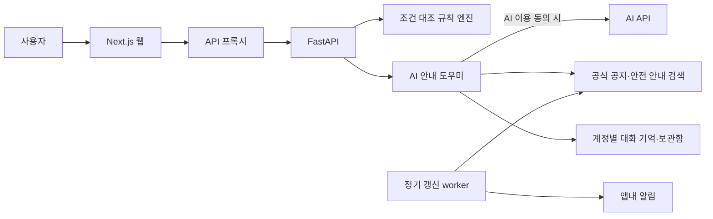

# 배터리체크

보조배터리의 공식 리콜 공지 조건을 내 제품과 대조하고, AI 안내 도우미가 근거와 다음 행동을 쉬운 말로 설명하는 웹 서비스입니다. 확인한 제품은 보관함에 남기고 공지가 바뀌면 다시 알려 줍니다. **배터리 내부 상태·화재 확률·안전 점수를 산출하지 않으며 리콜 대상을 확정하지 않습니다.**

코디세이 AI 네이티브 Final Project(자율 주제) 결과물입니다. 요건별 충족 여부는 [준비 상태](docs/CONTEST_READINESS.md#4-코디세이-final-project-요건-대응)에 있습니다.

## 팀원 및 역할

| 이름 | 역할 | 담당 업무 |
|---|---|---|
| (기입 필요) | | |
| (기입 필요) | | |
| (기입 필요) | | |

실제 담당과 기여를 확정한 뒤 적습니다.

## 기술 스택

- **AI**: OpenAI 호환 Chat Completions API(코디세이 게이트웨이, 도구 사용 에이전트), 자체 문서 검색, 로컬 OCR(Apple Vision / Tesseract)
- **Backend**: Python, FastAPI, SQLite
- **Frontend**: Next.js, React (PWA)
- **Infra**: Docker Compose, Caddy(HTTPS) — 설정 파일만 준비, 공개 배포 전

선정 이유는 [구현 구조](docs/ARCHITECTURE.md#기술-선정-이유)에 있습니다.

## 시스템 아키텍처



상세 구조와 API는 [구현 구조](docs/ARCHITECTURE.md)를 참고하세요.

## 핵심 AI 활용

1. **AI Agent** — 질문을 받으면 모델이 `search_official_documents`, `get_my_products`, `check_product` 중 필요한 도구를 골라 호출하고 결과를 종합합니다.
2. **RAG** — 저장된 CPSC 공지와 소방청·산업통상자원부 안전 안내를 검색해 그 내용만 근거로 답하고, 참고한 자료의 링크를 답변 아래에 표시합니다.
3. **Long-term Memory** — 계정별 대화를 저장해 다음 질문에 이전 맥락을 이어 가고, 보관함의 제품·조치 이력을 조회합니다.
4. **자동화 워크플로우** — worker가 공지 수집 → 저장 제품 재확인 → 변경 감지 → 앱내 알림을 주기적으로 실행합니다(LLM 미사용).

AI 윤리: 모든 답변에 "AI 생성 답변 · 공식 판정 아님"을 표시합니다. AI 도우미는 가입 동의와 별개의 동의를 받은 계정에서만 작동하고, 그때만 질문과 보관함 요약(브랜드·모델·판매지역·제조일·로트·조치 상태·확인 결과)을 외부 AI API에 보냅니다. 사진은 보내지 않습니다. 리콜 후보 판정과 위험징후 문구는 AI가 아니라 규칙과 검토된 문서가 정합니다.

**검증 범위:** 에이전트는 가짜 클라이언트를 쓴 자동 테스트로 확인했습니다. 2026-10-06에 로컬에서 코디세이 게이트웨이의 `gpt-5.4`로 실제 질문 2건(보관함 조회·출처 표시, 이전 대화 기억)을 확인했습니다. 답변 품질을 체계적으로 평가한 것은 아닙니다.

## 현재 기능

- AI 안내 도우미(동의 계정), 대화 기록 조회·삭제, 사용 의견 보내기
- 계정 가입·로그인·로그아웃, 사용자별 제품·이력·알림 격리
- 사진의 브랜드·모델 후보 추출 → 사용자 직접 확인 → 조건 대조
- CPSC 공식 웹에서 확인한 Anker A1263 / INIU BI-B41 공지 후보와 원문·미확인 조건 표시
- CPSC 공개 API 어댑터, 오류·만료·원문 해시·변경 버전 관리
- 제품 보관함, 재확인 이력, 사용자 조치 자기보고, 삭제
- 수신 동의 기반 앱내 알림, 변경 중복 방지, 선택적 정기 갱신 worker
- 개인정보 내보내기·계정 삭제, 반응형 화면, PWA 공개 오프라인 안내
- 별도 가상 DEMO LAB 제품의 조건 판정 시연

**연동 현황:** CPSC API의 실제 공개 요청은 HTTP 503을 반환했습니다. 공식 웹 확인 자료 2건을 API 성공처럼 취급하지 않습니다. Safety Korea는 인증키·승인이 없어 미연결입니다. 실제 제품은 후보 검색 후 추가 확인으로 안내하며 해외 공지가 국내 회수 자격을 보장하지 않습니다. 공식 자료에 없는 제품도 등록할 수 있으나 조회 미완료가 안전 판정으로 바뀌지 않습니다.

## 실행 방법

요구사항: Python 3.13+ (3.14에서 테스트), Node.js 20+

```sh
git clone <저장소 URL>
cd batterycheck
python3 -m venv .venv
.venv/bin/python -m pip install -r backend/requirements.txt
npm ci --prefix frontend --ignore-scripts --no-audit --no-fund
NEXT_TELEMETRY_DISABLED=1 npm run build --prefix frontend
export OPENAI_API_KEY=...   # AI 도우미용. 없으면 도우미만 꺼지고 나머지는 동작
python3 scripts/run_local.py
```

웹: `http://127.0.0.1:3114` / API: `http://127.0.0.1:8814`. 두 포트가 비어 있어야 하며 종료는 Ctrl+C입니다. `run_local.py`는 프로젝트의 `.venv`를 먼저 쓰고, 다른 환경은 `BATTERYCHECK_PYTHON=/absolute/path/to/python`으로 지정합니다. 프로젝트 루트의 `.env`(Git 제외)가 있으면 읽으며, 셸에 설정한 값이 우선합니다. 코디세이 API 콘솔의 OpenAI 호환 키를 쓰려면 `.env.example`의 `OPENAI_BASE_URL` 예시를 따르세요. 모델은 `BATTERYCHECK_AI_MODEL`로 바꿀 수 있습니다(기본 `gpt-5.4`).

Mac OCR은 Apple Vision과 Swift 컴파일러를 사용합니다. 첫 실행 시 프로젝트의 `.data/ocr`에 인식 실행 파일을 생성합니다. Linux에서는 Tesseract가 필요하며 배포용 Dockerfile에 설치 과정이 있습니다. 두 엔진은 별도이며 실제 검증한 엔진과 데이터 범위는 [최종 검증 기록](verification/final_report.md)에 기재합니다. 사진은 4MB·2천만 화소 이하 PNG/JPEG만 지원하고, 인식 후 임시 원본을 삭제합니다. 사진은 외부 AI에 전송하지 않습니다.

## 사용 순서

1. 직접 입력하거나 계정 생성 후 라벨 사진을 올립니다. 사진 후보를 적용해도 모델명 확인 체크는 자동으로 켜지지 않습니다.
2. 브랜드와 정확한 모델명을 직접 확인합니다. 제조일·지역·로트는 모르면 비워둡니다. 실제 시리얼은 제조사 페이지에서 확인합니다.
3. 조건 대조 결과의 출처·시각·미확인 조건을 읽습니다. `ANKER / A1263`은 공식 공지 후보 예이며 대상 확정 시연이 아닙니다.
4. 보관함에 저장하고 조치 상태를 기록합니다. 사용자 완료 신고는 회수 인증이나 사용 재개 허가가 아닙니다.
5. 계정 관리에서 앱내 알림에 동의합니다. `공식 자료 갱신 · 내 제품 재확인`이 변경된 근거를 확인합니다. API 실패 시 실패 상태와 마지막 자료 시각을 표시합니다.
6. `AI 안내 도우미`에서 전송 동의에 체크하고 제품이나 공지에 대해 질문합니다. 답변 아래의 공식 자료 링크로 조건을 직접 확인합니다.
7. 제품 삭제, 대화 기록 지우기, 내 기록 내려받기, 계정 영구 삭제를 사용할 수 있습니다.

`가상 예시 채우기`는 기존 DEMO LAB 조건 대조 시연입니다. 제조일/판매지역/로트가 모두 맞는 경우, 누락, 만료, 장애를 구분합니다. 가상 자료의 고정 기준 시각은 7일 후 만료되며 실제 API 갱신 시각으로 바꾸지 않습니다.

## 정기 갱신과 데이터

기본 실행에는 정기 worker가 포함되지 않습니다. 켜려면 프로젝트 루트에서 다음을 실행합니다. 공식 공개 공지는 한 번 수집하고 수신 동의한 사용자의 실제 제품만 재확인합니다. 앱내 알림을 만들며 이메일·문자·OS 푸시는 보내지 않습니다.

```sh
PYTHONPATH=backend .venv/bin/python -m batterycheck.worker --once
PYTHONPATH=backend .venv/bin/python -m batterycheck.worker --interval 21600
```

데이터는 `backend/.data/batterycheck.sqlite3`, 공개 공지 버전은 `backend/.data/official/`에 있습니다. 계정별 접근을 검증한 단일 서버 구성입니다. 여러 API 인스턴스 운영이나 PostgreSQL 전환은 구현하지 않았습니다. 소유자 없는 이전 시연 제품은 새 사용자에게 노출하지 않습니다. 사진 원본·평문 비밀번호를 DB에 보관하지 않습니다. 비밀번호 복구 메일은 제공하지 않습니다.

## 검증

```sh
PYTHONPATH=backend PYTHONWARNINGS=error::ResourceWarning .venv/bin/python -m unittest discover -s backend/tests -v
npm test --prefix frontend
NEXT_TELEMETRY_DISABLED=1 npm run build --prefix frontend
# 위 로컬 서버를 실행한 상태에서
python3 scripts/smoke_http.py
node frontend/tests/browser-e2e.mjs
node frontend/tests/auth-tabs-e2e.mjs
node frontend/tests/pwa-e2e.mjs
node frontend/tests/ocr-eval.mjs
```

테스트는 생성한 계정을 마지막에 삭제합니다. 브라우저 검증은 기존 Chromium을 headless로 실행하며 외부 페이지 요청을 차단합니다. OCR의 합성 라벨 시험은 실제 생활사진 인식 정확도나 사용자 실증과 구분합니다. `verification/summary.json`과 `IMPLEMENTATION_2026-10-02.md`는 최초 가상 데모 기록이며 **최신 결과는 `verification/final_report.md`와 `summary-v2.json`**입니다.

## 사용자 테스트 결과

아직 실시하지 않았습니다. 팀원을 제외한 5명 이상을 대상으로 [검증 절차](docs/USER_VALIDATION.md)에 따라 진행하고, 인원·피드백·반영 내용을 여기에 적습니다. 앱 화면 아래 `사용 의견 보내기`로도 의견을 받습니다.

## 링크와 문서

- 배포 URL: 미배포
- 발표 자료: [발표 개요](docs/PRESENTATION.md) (슬라이드 작성 전), [시연 흐름](docs/DEMO_SCRIPT.md)
- [기획서](docs/PROJECT_PLAN.md) · [요구사항 정의서](docs/REQUIREMENTS.md) · [구현 구조와 AI 설계](docs/ARCHITECTURE.md)
- [과제 요건과 준비 상태](docs/CONTEST_READINESS.md) · [사용자 검증 절차](docs/USER_VALIDATION.md)
- [공식 출처와 API 실행 증거](docs/SOURCES.md) · [배포 절차](docs/DEPLOYMENT.md) · [최종 검증 기록](verification/final_report.md)

공개 배포, Git 저장소 생성·푸시, Safety Korea 승인, 실제 사용자 참여, 안전 전문가 검토는 아직 하지 않았으며 코드 구현으로 대신하지 않습니다.

## 라이선스

이 프로젝트의 새로 작성한 소스 코드는 [MIT](LICENSE)입니다. 공식 기관 문서·공지·상표·연결된 외부 자료에는 해당 권리자의 조건이 적용되며 이 라이선스에 포함되지 않습니다. 의존성은 각 패키지 라이선스를 따릅니다. [NOTICE](NOTICE.md)를 참고하세요.
